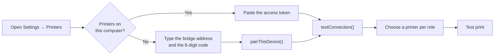

# Printer setup in your POS

This guide adds a **Printers** page to your POS settings: the shop connects
the POS to the bridge, picks which printer gets receipts, kitchen tickets and
invoices, and prints a test page. No code changes are needed when the shop
adds or swaps printers.

!!! tip "Using React?"
    The SDK has this page ready-made: `<PrinterSettings />` and a header
    `<PrinterStatusBadge />` from `pos-hardware-bridge/react`. See
    [React printer widget](react-widget.md). This guide explains how it works,
    for other frameworks or your own UI.

It comes as two files you can copy into your app:

| File | What it is |
| --- | --- |
| [`printing.ts`](https://github.com/Thisarahetz/pos-hardware-bridge/blob/master/examples/pos-setup/printing.ts) | The printing module: saved settings, connect, pair, print, live status. No UI, works with any framework. |
| [`PrinterSettings.tsx`](https://github.com/Thisarahetz/pos-hardware-bridge/blob/master/examples/pos-setup/PrinterSettings.tsx) | A React settings page built on it. Plain HTML, so restyle it with your own components. |

```bash
npm install pos-hardware-bridge
```

## What the shop sees

```text
Printers
┌─ 1. Connect to POS Hardware Bridge ───────────────────────────┐
│ (•) Printers are connected to this computer                    │
│ ( ) Printers are connected to another computer in the shop     │
│ Access token [••••••••••••••••]  [Connect]                     │
│ Connected to Front desk PC.                                    │
└────────────────────────────────────────────────────────────────┘
┌─ 2. Choose printers ───────────────────────────────────────────┐
│ Customer receipts  [Default printer        ▾]  [Test print]    │
│ Kitchen tickets    [Kitchen (not ready)    ▾]  [Test print]    │
│ A4 invoices        [Don't print            ▾]  [Test print]    │
└────────────────────────────────────────────────────────────────┘
┌─ 3. Options ───────────────────────────────────────────────────┐
│ [x] Print the receipt automatically after each sale            │
│ Copies [1]                                                     │
└────────────────────────────────────────────────────────────────┘
```



## What gets saved

The settings belong to **the device**, not the shop account: every computer
has its own token, and a till and a tablet may use different printers. The
module saves them in `localStorage`; use your app's own storage instead if you
have one (Electron store, secure storage on mobile). Never put the token in
your code or your database.

```ts
interface PrintSettings {
  url: string;                                   // http://127.0.0.1:9191, or the shop address on a tablet
  token: string;                                 // access token or device token
  printers: Record<'receipt' | 'kitchen' | 'invoice', string | null>;
                                                 // API name per role: '' = default printer, null = don't print
  autoPrint: boolean;
  copies: number;                                // 1–5
}
```

Saving `''` (the default printer) instead of a fixed name means the shop can
swap printers in the bridge without touching the POS.

## Connecting

There are two cases, and the page offers both:

- **The printers are on this computer.** The shop opens the bridge,
  **Connect your POS**, copies the access token and pastes it in. The address
  is always `http://127.0.0.1:9191`.
- **The printers are on another computer** (a tablet or second till). On the
  printer computer, they turn on **Phones & tablets** and click **Get a code**.
  The POS calls `pairThisDevice(address, code, name)` and saves the device
  token it gets back. See [Phones & tablets](devices.md).

`testConnection()` then checks three things in order, so the error says what
is wrong:

1. `GET /health`: is the bridge running at that address?
2. `GET /me`: is the token accepted?
3. `GET /printers`: which printers can this POS choose from?

Errors are `BridgeError`s whose `message` is written for the shop, for example
*"POS Hardware Bridge is not running on this computer. Open it from the Start
menu or the tray."* Show it as it is.

!!! tip "Web POS on `https://`"
    A hosted web POS can reach `http://127.0.0.1` from Chrome and Edge, but not
    a `http://192.168.…` address on another computer. For that case, use the
    [print station](print-station.md) instead of pairing.

## Printing from the POS

Call `printFor(role, receipt)` wherever the POS prints. It reads the saved
settings, sends the receipt to that role's printer and **never throws**, so a
printer problem can't break a sale:

```ts
import { ReceiptBuilder } from 'pos-hardware-bridge';
import { loadSettings, printFor } from './printing';

async function onSaleCompleted(sale: Sale) {
  await saveSale(sale);                                // 1. the sale is safe first

  if (!loadSettings().autoPrint) return;
  const result = await printFor('receipt', buildReceipt(sale), { title: `Bill #${sale.number}` });

  if (!result.ok && !result.skipped) {
    showToast(result.message, {
      // canRetry is false when the bridge didn't answer: the receipt may
      // already have printed, so ask the cashier before printing again.
      action: { label: 'Reprint', confirm: !result.canRetry, run: () => printFor('receipt', buildReceipt(sale)) },
    });
  }

  await printFor('kitchen', buildKitchenTicket(sale)); // skipped if set to "Don't print"
}

function buildReceipt(sale: Sale) {
  const r = new ReceiptBuilder().center('MY SHOP', { bold: true, size: 'large' }).rule();
  for (const line of sale.lines) r.item({ name: line.name, qty: line.qty, total: line.total });
  return r.rule('double').total('TOTAL', sale.total);
}
```

`result` is one of:

| Result | Meaning | Show |
| --- | --- | --- |
| `{ ok: true, printer }` | Printed | Nothing, or a short "Printed" |
| `{ ok: false, skipped: true }` | Not set up, or this role is *Don't print* | Nothing |
| `{ ok: false, message, canRetry }` | Didn't print | `message` and a **Reprint** button |

A4 invoices go through `printInvoice(html)` the same way. See
[Receipts, line by line](receipts.md) for everything `ReceiptBuilder` can do.

## Printer status in the POS header

`watchPrinterStatus()` gives a traffic light and one line of text, so the
cashier sees an unplugged printer before a customer is waiting:

```tsx
import { useEffect, useState } from 'react';
import { type PrinterStatusSummary, watchPrinterStatus } from './printing';

const COLORS = { ok: 'green', warning: 'orange', error: 'red', off: 'grey' };

export function PrinterStatusBadge() {
  const [status, setStatus] = useState<PrinterStatusSummary>({ light: 'off', text: 'Checking printers…' });
  useEffect(() => watchPrinterStatus(setStatus), []);
  return (
    <span title={status.text}>
      <span style={{ color: COLORS[status.light] }}>●</span> {status.text}
    </span>
  );
}
```

It listens to the bridge's live events and also checks every 10 seconds, so it
recovers by itself when the bridge restarts.

## The code

=== "printing.ts"

    ```ts
    --8<-- "examples/pos-setup/printing.ts"
    ```

=== "PrinterSettings.tsx"

    ```tsx
    --8<-- "examples/pos-setup/PrinterSettings.tsx"
    ```

## Other frameworks

`printing.ts` has no UI code. For Vue, Svelte, Angular or plain JavaScript,
keep the module and build the same three steps with your own components:

1. **Connect:** a token field (this computer) or address + code + device
   name (another computer) → `testConnection()` / `pairThisDevice()`.
2. **Choose printers:** one dropdown per role, filled from
   `connection.printers` (receipt printers for receipts and kitchen, A4
   printers for invoices), plus *Default printer* and *Don't print*.
   Save with `saveSettings()`.
3. **Options** and a **Test print** button per role → `printTestPage(role)`.

Not using JavaScript? The module is a thin layer over the
[HTTP API](../api.md): the same calls work from any language.

## Check before you ship

- [ ] Wrong token → the page says the token wasn't accepted.
- [ ] Bridge closed → the page says it isn't running.
- [ ] Printer unplugged → the header badge turns red within a few seconds,
      and a sale still completes with a **Reprint** option.
- [ ] *Don't print* on kitchen tickets → no request is sent.
- [ ] Printers renamed or swapped in the bridge → *Default printer* still works.
- [ ] A tablet pairs with a code, and printing still works after the app restarts.
