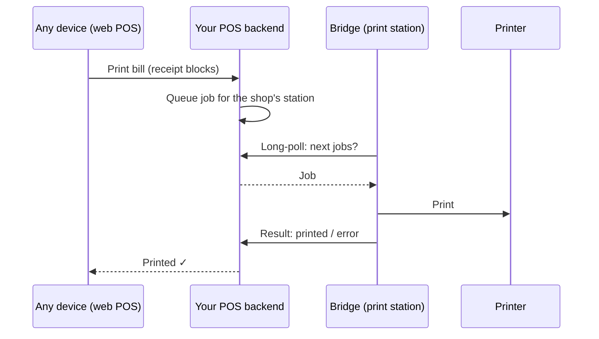

# Print station (for POS backends)

Let **every device of a shop print to its printers from anywhere** — tablets
on mobile data, a hosted web POS, another branch — through your POS backend.

The shop computer running the bridge becomes a *print station*. It keeps one
outgoing connection to your server and prints the jobs you queue, so it needs
no open ports, fixed IP address or router setup.

## The protocol

Implement five routes on your server — the full contract, with every field
and the rules that keep a bill from printing twice or late, is in the
[print station protocol](../reference/index.html) (*Print station protocol*
tab; raw spec: [`print-station.openapi.yaml`](https://github.com/Thisarahetz/pos-hardware-bridge/blob/master/docs/print-station.openapi.yaml)).

| Route | Purpose |
| --- | --- |
| Pair | The bridge swaps a 6-digit code your POS showed the shop owner for a station token |
| Status (heartbeat) | Every 30 s: the station's printers, their status and `columns` |
| Next jobs | Long-poll (up to 25 s) for jobs to print |
| Job result | `printed` or `failed` with the printer's error, written for the cashier |
| Disconnect | The station unpairs itself |

A job carries what to print — a line-by-line `receipt` (`{ "blocks": [...] }`,
the same as [`POST /print/receipt`](receipts.md)), or an `html` page for A4/A5
printers — plus the printer's API name, copies and a title.

## Setup at the shop

1. In your POS, the owner opens a *Add print station* screen that shows your
   server address and a 6-digit code (valid for 10 minutes).
2. In the bridge, under **Connect your POS → With a code**, they enter that
   address, a name for the computer (e.g. *Front counter PC*) and the code,
   then click **Connect**.
3. The station shows up in your POS with its printers. From then on, every
   device can print to it.

## Built so a bill never prints twice or late

- Jobs that aren't picked up in time expire, so a bill never prints an hour
  later when the computer wakes up. Offer the cashier another way to print.
- The bridge remembers the jobs it printed: if the connection drops after
  printing, a job delivered again is reported, not printed again.
- After sleep, a network change or a server restart, the bridge reconnects by
  itself.
- The station token is kept in the computer's keychain (Windows DPAPI, macOS
  Keychain) and never shown. **Disconnect** in the bridge revokes it.

## Previews in your POS

The heartbeat reports each receipt printer's `columns` (32, 42 or 48). Lay the
receipt out with the SDK's [`layoutReceipt`](receipts.md#previews-that-match-the-paper)
at that width and your preview matches the paper exactly.

!!! example "A complete implementation"
    AI POS implements this protocol end to end: a print menu on every device, live printer status, and previews laid
    out with the shared layout code.
