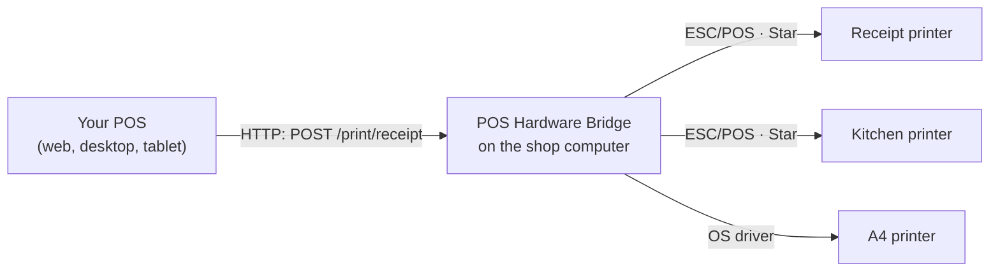

---
hide:
  - navigation
---

# POS Hardware Bridge

**Print receipts, kitchen tickets and A4 invoices from any POS — on any
thermal printer.** A free, open-source tray app for Windows, macOS and Linux.

Browsers can't talk to USB receipt printers or card terminals. POS Hardware
Bridge runs on the shop computer, sets the printers up for you, and gives your
POS a simple HTTP API on `http://127.0.0.1:9191`. Your POS sends a receipt;
the bridge prints it.

[Download](getting-started/install.md){ .md-button .md-button--primary }
[Your first print in 5 minutes](getting-started/first-print.md){ .md-button }

---

<div class="grid cards" markdown>

-   :material-printer-pos:{ .lg } **Sharp receipts on any printer**

    Receipts are sent line by line and printed with the printer's own fonts —
    never as a blurry picture. Works with any ESC/POS or Star printer, 58mm
    or 80mm.

-   :material-usb:{ .lg } **Plug and play**

    Plug in a USB receipt printer and it's ready in seconds. Network printers
    are found with one click. Your POS never configures a printer.

-   :material-printer-settings:{ .lg } **Many printers, one computer**

    Front counter, kitchen and A4 invoice printers side by side. The POS
    picks one by name: `receipt`, `kitchen`, `invoice`.

-   :material-tablet-cellphone:{ .lg } **Every device in the shop**

    Phones, tablets and other tills print here too — over the shop Wi-Fi, or
    from anywhere through your POS backend.

-   :material-traffic-light:{ .lg } **Clear status**

    The tray icon and the API say whether each printer is ready, and tell the
    cashier exactly what to do when it isn't.

-   :material-code-json:{ .lg } **Made for developers**

    A documented [HTTP API](api.md), an [npm SDK](sdk.md) with TypeScript
    types, and an open [print station protocol](guides/print-station.md).

</div>

## How it works



## Print a receipt

=== "SDK (JavaScript / TypeScript)"

    ```js
    import { BridgeClient, ReceiptBuilder } from 'pos-hardware-bridge';

    const bridge = new BridgeClient({ token: '<access token>' });

    await bridge.printReceipt(
      new ReceiptBuilder()
        .center('MY SHOP', { bold: true, size: 'large' })
        .rule()
        .item({ name: 'Latte', qty: 2, total: '9.00' })
        .rule('double')
        .total('TOTAL', '9.00')
        .qr('https://myshop.example/r/1042', 'Scan for your e-receipt'),
    );
    ```

=== "HTTP (any language)"

    ```bash
    curl -X POST http://127.0.0.1:9191/print/receipt \
      -H "Authorization: Bearer $TOKEN" \
      -H "Content-Type: application/json" \
      -d '{
        "blocks": [
          { "type": "text", "text": "MY SHOP", "align": "center", "bold": true, "size": "large" },
          { "type": "rule" },
          { "type": "row", "left": "2 x Latte", "right": "9.00", "bold": true },
          { "type": "rule", "style": "double" },
          { "type": "row", "left": "TOTAL", "right": "9.00", "bold": true, "size": "tall" },
          { "type": "qr", "data": "https://myshop.example/r/1042", "label": "Scan for your e-receipt" }
        ]
      }'
    ```

The bridge wraps the text for the paper — 32 characters on 58mm, 42 or 48 on
80mm — so the same receipt prints correctly everywhere.

## Open source

POS Hardware Bridge is [MIT licensed](https://github.com/Thisarahetz/pos-hardware-bridge/blob/master/LICENSE).
Issues, printer reports and pull requests are welcome — see
[Contributing](contributing.md).
